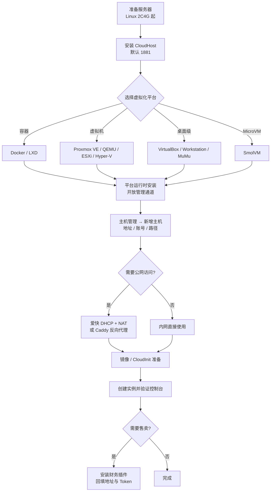

# 部署教程总览

本节说明主控安装、虚拟平台接入、网络配置、镜像准备和财务系统插件。单机部署步骤见[项目简介中的快速部署](/intro/quick-start)。

## 章节导航

| 章节 | 内容 | 适用场景 |
|---|---|---|
| [主控安装](/deploy/core-install) | Linux / Windows / macOS、源码与参数 | 安装或升级主控 |
| [虚拟平台部署](/deploy/platform/) | Docker、LXD、Proxmox、ESXi、Hyper-V、QEMU、VirtualBox、SmolVM、MuMu | 接入虚拟化平台 |
| [网络设置](/deploy/network) | 爱快安装、DHCP、NAT、拓扑 | 配置网络 |
| [主机配置](/deploy/host-config/) | 各平台在主控中的配置项 | 添加宿主机 |
| [镜像与初始化](/deploy/images) | 成品镜像、自制镜像、CloudInit | 准备实例镜像 |
| [CloudInit](/deploy/cloudinit) | 虚拟机内 Agent 的安装与配置 | 配置 IP 上报和初始化 |
| [财务对接](/deploy/finance/) | IDCSmart、SwapIDC、Easypanel、VistaPanel | 安装财务插件 |

## 全链路流程图



## 三种典型拓扑

### 1. 单机全栈（体验 / 小规模）

```text
一台 Linux
├── CloudHost（1881）
├── Docker / LXD
└── Caddy（可选）
```

主控与平台同机，主机地址填 `localhost` 或留空即可。

### 2. 主控 + 多台宿主机（常见生产）

```text
CloudHost（公网 / 内网）
   ├── Proxmox VE 10.0.0.21:8006
   ├── LXD      10.0.0.32（SSH）
   └── Hyper-V  10.0.0.44:5985
```

主控通过 API / SSH 管理宿主机；用户只访问主控。

### 3. 主控 + 爱快中转（无独立公网 IP）

```text
用户 → 公网 IP（爱快） → DNAT → 实例
主控 → 爱快 API（DHCP 静态绑定）
```

主机配置的「反向代理模式」选 `relay`，并填写中转地址。

## 端口清单

| 端口 | 服务 | 说明 |
|---|---|---|
| 1881 | CloudHost HTTP | 面板与 API，建议反代 443 |
| 6080 | VNC 代理 | 可走 `wss` |
| 7681 | Web SSH | 建议限制来源 |
| 2019 | Caddy Admin | 仅本机 |
| 8006 / 443 / 5985 / 8697 | 平台 API | 仅主控可达 |

## 部署前检查

- [ ] 服务器虚拟化已开启（`egrep -c '(vmx|svm)' /proc/cpuinfo` 大于 0）
- [ ] 时间同步（`timedatectl` / NTP）
- [ ] 磁盘规划：系统盘之外预留镜像与备份目录
- [ ] 防火墙放行主控与平台端口
- [ ] 准备好系统标题与管理员密码（首次访问初始化页面时设置，不再使用 Bearer Token 登录）

## 下一步

1. [安装主控](/deploy/core-install)
2. [选择并部署平台](/deploy/platform/)
3. [把主机填进主控](/deploy/host-config/)
