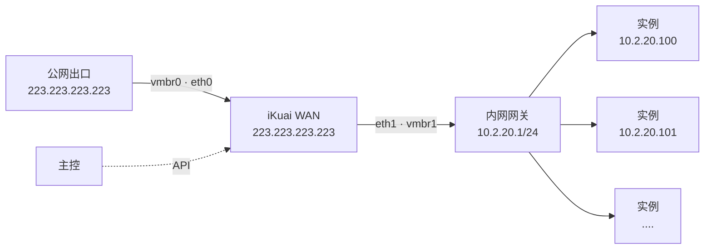
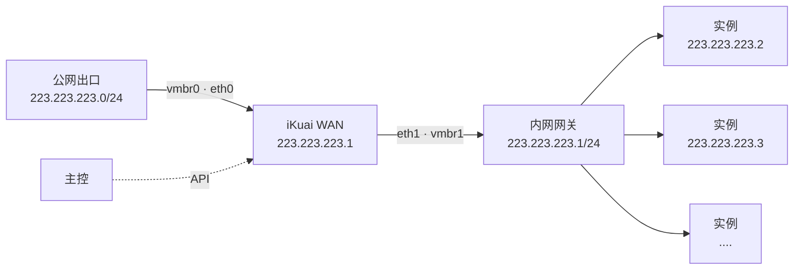
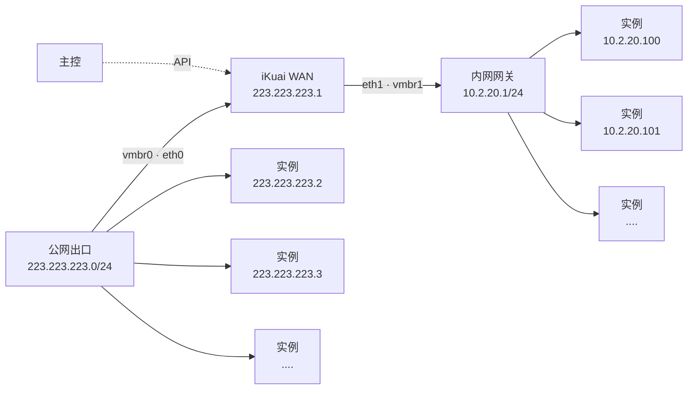

# 运行原理 · IPv4

iKuai 站在公网和内网之间，按实例要不要独立公网 IP，有三种接法。先看懂结构，再动手装。

## 内网 NAT 机 IP 分配流程
一台 iKuai 虚拟机站在公网和内网中间，各接一张虚拟网卡：一张朝外接公网，一张朝内接实例

此时`vmbr0`是公网网卡，面向外部流量NAT，`vmbr1`是内网网卡，面向虚拟机分配IPV4地址使用

在主控上，只需要将`vmbr1`填入内网网卡（表单里叫「共享 IP 设备名」），公网网卡（「独立 IP 设备名」）留空！！

拆开看三段：

- **外网到 iKuai**：上游给一个公网地址（示例 `223.223.223.223`），直连宿主机公网网卡并桥到 `vmbr0`，iKuai 的 `eth0` 就配这个地址。这是整台机器唯一的公网地址，端口映射都打在它上面。
- **iKuai 内部**：WAN 和 LAN 之间做 NAT。实例出网时源地址被换成 `223.223.223.223`；公网访问 `223.223.223.223:端口` 时，由 iKuai 按映射转发到对应实例。
- **iKuai 到实例**：`eth1` 接内网网桥 `vmbr1`，配 `10.2.20.1/24`，作为所有实例的网关和 DNS。实例地址从 `10.2.20.100` 起，由主控从地址池分配。

主控不转发流量，只通过爱快 API 管三件事：给实例下发 DHCP 静态绑定、写 ARP 绑定、设置上下行限速。所以 iKuai 自带的 DHCP 要关掉，地址统一由主控分配。

### IP 分配结构

| 角色 | 示例地址 | 说明 |
|---|---|---|
| 公网出口 | `223.223.223.223` | 上游给的单公网 IP，NAT 后对外都是它 |
| iKuai WAN（eth0 / vmbr0） | `223.223.223.223` | 和公网出口是同一个地址 |
| iKuai LAN（eth1 / vmbr1） | `10.2.20.1/24` | 内网网关，实例的网关与 DNS 指向它 |
| 实例地址池 | `10.2.20.100` 起 | 主控「IP 地址池」里配置，网关填 `10.2.20.1` |
| 子网掩码 | `255.255.255.0` | 与 LAN 保持一致 |
| DNS | `223.5.5.5` | 由 iKuai 下发，或写死在实例里 |

这种模式对外只有一个地址，加实例靠端口映射区分，适合只拿到一个公网 IP 的机器。要给实例真正的公网地址，看下面的独立 IP 模式。

## 公网独立 IP 机分配流程
一台 iKuai 虚拟机在公网上拿到一个网段（`223.223.223.0/24`），再把这个网段直接分给实例（`223.223.223.2`–`223.223.223.254`）

在主控上，只需要将`vmbr1`填入公网网卡（「独立 IP 设备名」）即可，内网网卡需要留空！！

这种模式不做 NAT：iKuai 的 LAN 口直接拿公网段的 `.1` 当网关，实例从 `.2` 起分到公网地址，外部能直接访问，不用端口映射。

| 角色 | 示例地址 | 说明 |
|---|---|---|
| 公网段 | `223.223.223.0/24` | 上游把整段路由到这台机器 |
| iKuai WAN（eth0 / vmbr0） | `223.223.223.1` | 与 LAN 同段 |
| iKuai LAN（eth1 / vmbr1） | `223.223.223.1/24` | 实例的网关与 DNS |
| 实例地址池 | `223.223.223.2` 起 | `.1` 留给网关，`.255` 是广播地址不能分 |

带宽限制、ARP 绑定照旧由爱快执行。

## 公网 + 内网混合 IP 分配
当然，可以混合IP分配，此时爱快分配内网IP，公网IP直接使用`vmbr0`网桥桥接

在主控上，只需要将`vmbr0`填入公网网卡，`vmbr1`填入内网网卡即可

两类实例并存：

- 要公网 IP 的实例，网卡直接桥到 `vmbr0`，从 `223.223.223.0/24` 里分地址，不经过爱快；
- 要内网 IP 的实例，网卡桥到 `vmbr1`，由爱快分配 `10.2.20.x`，出网走 NAT。

公网实例和 iKuai 的 WAN 在同一网段，`.1` 留给网关，地址池从 `.2` 起，别分重复。
