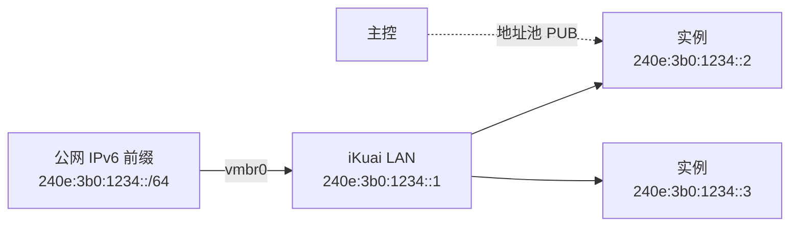
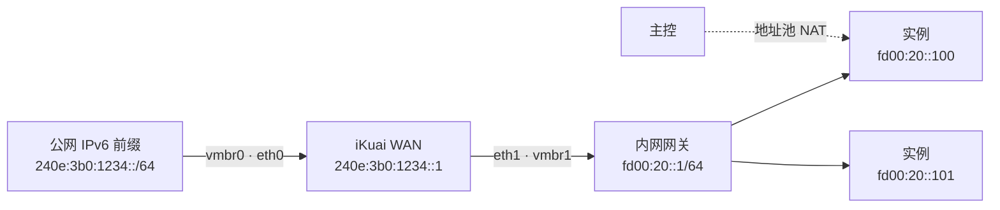

# 运行原理 · IPv6

IPv6 同样分公网和内网两种用法，区别只在地址池的类型：`PUB` 把公网前缀直接分给实例，`NAT` 给实例分内网段、出门再转换。

## 公网 IPv6

上游把一段前缀路由到这台宿主机（示例 `240e:3b0:1234::/64`），网卡直接承载这段地址，iKuai 的 LAN 口取 `::1` 当网关，实例从 `::2` 起分地址。

这种模式不做地址转换，实例到公网是直达的，对外开哪些端口由实例自己的防火墙决定，不用端口映射。

## 内网 IPv6

公网前缀只落在 iKuai 的 WAN 上，LAN 侧另起一段内网地址（示例 `fd00:20::/64`），实例拿内网地址，出网由 iKuai 转发。

实例之间互通，对外不可直达；要暴露服务仍然走端口映射，和 IPv4 的 NAT 一样。

内网段用什么、出网是 NAT66 还是路由，取决于你在 iKuai 里怎么配；主控只负责按地址池把地址写进实例。

## 地址池字段

主机 → 编辑 → 网络配置 → IP 地址池，两种模式都在这加，区别是版本、类型和网段：

| 字段 | 公网模式 | 内网模式 | 说明 |
|---|---|---|---|
| 名称 | `v6-pub` | `v6-nat` | 地址池标识 |
| 版本 | `IPv6` | `IPv6` | 和 IPv4 池分开配 |
| 类型 | `PUB` | `NAT` | 是否直通公网 |
| 起始 IP | `240e:3b0:1234::2` | `fd00:20::100` | 前缀里第一个可分配地址 |
| 网关 | `240e:3b0:1234::1` | `fd00:20::1` | 实例的默认网关 |
| 前缀长度 | `64` | `64` | 范围 1–128，默认 64 |
| 数量 | `10` | `10` | 这条池能分多少个 |

## 两种模式怎么选

| 场景 | 选 |
|---|---|
| 机房给了整段公网 IPv6，实例要能直接被访问 | 公网模式 |
| 只拿到少量公网地址，或者实例需要隔离 | 内网模式 |

## 和 IPv4 的区别

- 掩码字段变成前缀长度，填 `64`，不是 `255.255.255.0`；
- 公网模式下地址直接可达，不需要端口映射；
- ARP 绑定、DHCP 静态绑定都是 IPv4 的机制，IPv6 侧不依赖 DHCP，地址直接写进实例；
- 实例详情页会单列「IPv6 地址」，和 IPv4 一起展示。

## 参考内容

- [网络端口](/features/network)
- [端口转发](/usage/nat)
- [反向代理](/usage/proxies)
