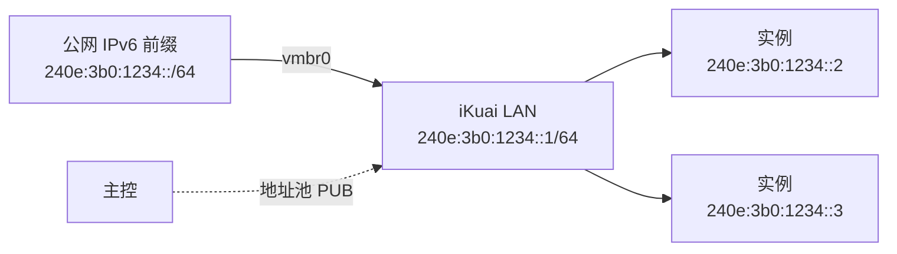
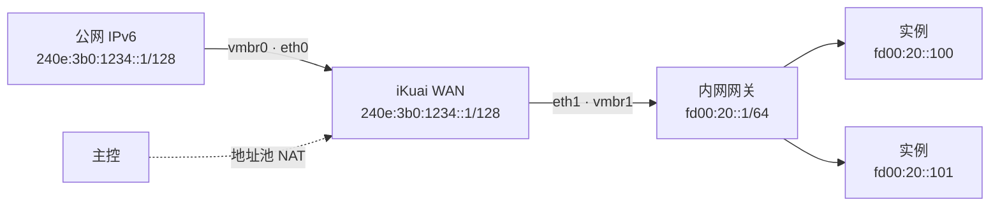

# 运行原理 · IPv6

IPv6 同样分公网和内网两种用法，区别只在地址池的类型：`PUB` 把公网前缀直接分给实例，`NAT` 给实例分内网段、出门再转换。

## 公网 IPv6

上游把一段前缀路由到这台宿主机（示例 `240e:3b0:1234::/64`），网卡直接承载这段地址，iKuai 的 LAN 口取 `::1` 当网关，实例从 `::2` 起分地址。

这种模式不做地址转换，实例到公网是直达的，对外开哪些端口由实例自己的防火墙决定，不用端口映射。

### 前缀怎么分

公网 IPv6 有两种拿法，地址池填法不一样：

| 拿到的资源 | 起始 IP | 前缀 | 数量 |
|---|---|---|---|
| 整段（`/56`、`/40` 等） | 挑一个 `/64` 里的第一个可分配地址，如 `240e:3b0:1234:5600::2` | `64` | 按需 |
| 单个 `/128` | 地址本身，如 `240e:3b0:1234:5600::2` | `128` | `1` |
| 小段（`/96` 等） | 段内第一个可分配地址 | `96` | 段内可用数量 |

主控按「起始地址逐个 +1」分配，不按前缀切子网，也不检查越界；起始地址和数量要自己保证落在你拥有的段里。

`/128` 只有一个地址，数量必须填 `1`；要给多台实例，就建多条地址池，或者把起始地址往后排。

### 主控和爱快各支持到哪

| 环节 | 支持情况 |
|---|---|
| 主控地址池 | 前缀长度 `1`–`128` 都收，只当掩码写进实例（`ip6_prefix`），解析不出时按 `/64` 兜底 |
| 主控分配 | 连续 +1 分配，`/64`、`/96`、`/128` 都能配 |
| 爱快静态绑定 | 只支持「MAC + 后 64 位后缀」的 DHCPv6 静态分配，对应 `/64` |
| `/96`、`/128` | 不要依赖爱快的 DHCPv6 静态绑定，用 `PUB` 直通、地址直接写进实例 |

原因是爱快的 IPv6 静态分配提交的是接口标识（后 64 位），前缀由运营商动态下发；地址不是落在 `/64` 语义里时，它下发出来的地址可能和地址池里那条对不上。

### 静态地址怎么落地

主控分配 IPv6 时按前缀收敛：`/128` 只发一个地址，`/96`、`/112` 这类小段分到段尾就停，不会把段外地址发给实例。地址落到实例里，各平台走的路子不一样：

| 平台 | 落地方式 |
|---|---|
| KVM / QEMU | 创建时把 IPv4 / IPv6 一起写进 cloud-init 的 systemd-networkd 和 netplan，开机就是静态地址 |
| LXD / LXC | 下发 `ipv6.address` 到 eth0 设备，容器重建网卡也保持 |
| Proxmox VE、ESXi、Hyper-V、VirtualBox、MEmu | 驱动不注入 guest 配置，靠爱快的 DHCP / DHCPv6 静态绑定（MAC + 后缀）固定地址，只适配 `/64` |

`/96`、`/128` 这类没有 64 位前缀空间、又要静态地址的场景，用 KVM / QEMU 或 LXD；走 Proxmox 等平台时按 `/64` 分配。

## 内网 IPv6

公网前缀只落在 iKuai 的 WAN 上，LAN 侧另起一段内网地址（示例 `fd00:20::/64`），实例拿内网地址，出网由 iKuai 转发。

实例之间互通，对外不可直达；要暴露服务仍然走端口映射，和 IPv4 的 NAT 一样。内网段用 `/64` 就够，前缀长度填 `64`。

内网段用什么、出网是 NAT66 还是路由，取决于你在 iKuai 里怎么配；主控只负责按地址池把地址写进实例。

## 地址池字段

主机 → 编辑 → 网络配置 → IP 地址池，两种模式都在这加，区别是版本、类型和网段：

| 字段 | 公网模式 | 内网模式 | 说明 |
|---|---|---|---|
| 名称 | `v6-pub` | `v6-nat` | 地址池标识 |
| 版本 | `IPv6` | `IPv6` | 和 IPv4 池分开配 |
| 类型 | `PUB` | `NAT` | 是否直通公网 |
| 起始 IP | `240e:3b0:1234::2` | `fd00:20::100` | 前缀里第一个可分配地址 |
| 网关 | `240e:3b0:1234::1` | `fd00:20::1` | 实例的默认网关 |
| 前缀长度 | `64` | `64` | 掩码长度：`64` 就是分一个 `/64`，`128` 只有一个地址；支持 `1`–`128`，常用 `64`–`128` |
| 数量 | `10` | `10` | 这条池能分多少个 |

## 两种模式怎么选

| 场景 | 选 |
|---|---|
| 机房给了整段公网 IPv6，实例要能直接被访问 | 公网模式 |
| 只拿到少量公网地址，或者实例需要隔离 | 内网模式 |

## 和 IPv4 的区别

- 掩码字段变成前缀长度：`64` 是分一个 `/64`，`128` 是只给一个地址，不是 `255.255.255.0`；
- 公网模式下地址直接可达，不需要端口映射；
- ARP 绑定、DHCP 静态绑定都是 IPv4 的机制，IPv6 侧不依赖 DHCP，地址直接写进实例；
- 实例详情页会单列「IPv6 地址」，和 IPv4 一起展示。

## 参考内容

- [网络端口](/features/network)
- [端口转发](/usage/nat)
- [反向代理](/usage/proxies)
