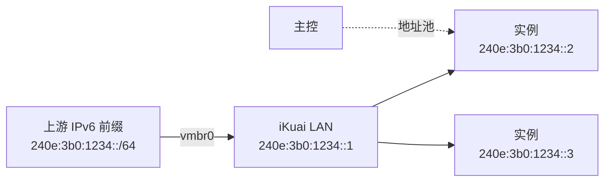

# 运行原理 · IPv6

IPv6 和 IPv4 最大的差别是地址够用，通常不做 NAT：公网前缀直接分给实例，一个实例一个地址。

## 地址怎么走

上游把一段前缀路由到这台宿主机（示例 `240e:3b0:1234::/64`），网卡直接承载这段地址，iKuai 的 LAN 口取 `::1` 当网关，实例从 `::2` 起分地址。

## 主控里怎么配

主机 → 编辑 → 网络配置 → IP 地址池，加一条：

| 字段 | 示例 | 说明 |
|---|---|---|
| 名称 | `v6-pool` | 地址池标识 |
| 版本 | `IPv6` | 和 IPv4 池分开配 |
| 类型 | `PUB` | 独立地址直通公网 |
| 起始 IP | `240e:3b0:1234::2` | 前缀里第一个可分配地址 |
| 网关 | `240e:3b0:1234::1` | 实例的默认网关 |
| 前缀长度 | `64` | 范围 1–128，默认 64 |
| 数量 | `10` | 这条池能分多少个 |

## 和 IPv4 的区别

- 掩码字段变成前缀长度，填 `64`，不是 `255.255.255.0`；
- 一般不做端口映射，地址直接可达，对外开哪些端口由实例自己的防火墙管；
- ARP 绑定、DHCP 静态绑定都是 IPv4 的机制，IPv6 侧不依赖 DHCP，地址直接写进实例；
- 实例详情页会单列「IPv6 地址」，和 IPv4 一起展示。

## 参考内容

- [网络端口](/features/network)
- [端口转发](/usage/nat)
- [反向代理](/usage/proxies)
