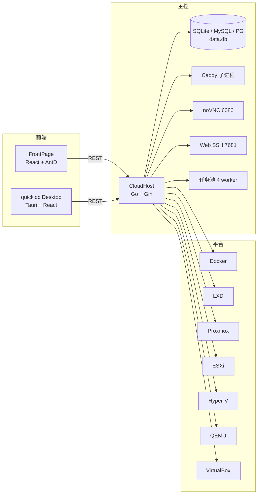

# 项目结构

快简云由多个仓库组成，各自独立发布，通过 REST API 与约定的数据格式协作。这一章先讲仓库和技术栈，再讲怎么搭环境、构建和发布。

## 仓库

| 仓库 | 作用 | 技术栈 | 产物 |
|---|---|---|---|
| `QuickIDC/CloudHost` | 主控 + 财务插件 | Go 1.26、Gin、SQLite、Cobra | 单二进制 `hostagent`、安装包 |
| `QuickIDC/FrontPage` | 浏览器控制台 | React 18、TypeScript、Vite、Ant Design | 静态站点（打进主控 `static/`） |
| `QuickIDC/CloudInit` | 虚拟机内 Agent | Go | `cloudinit` 二进制 |
| `QuickIDC/Documents` | 文档站 | VitePress、Vue 3 | 静态站点（GitHub Pages） |
| `QuickIDC/XiaoheiFS` | 业务侧系统（独立） | Go + React + Flutter | 各自产物 |

> 财务插件已并入 `CloudHost/plugins/`，不再单独发布仓库。

## 技术栈



## 主控目录

```text
CloudHost/
├── cmd/
│   ├── server/          # 主控入口（cobra）
│   └── quickidc/        # 管理命令行
├── internal/
│   ├── api/             # 路由与 handler
│   ├── auth/            # 认证、CSRF、权限
│   ├── data/            # SQLite 访问层
│   ├── driver/          # 各平台驱动 + 引擎元信息
│   ├── model/           # 数据模型
│   ├── scheduler/       # 定时任务
│   ├── security/        # 加密、主机密钥
│   ├── service/         # 业务服务（主机/代理/NAT/…）
│   └── task/            # 异步任务
├── pkg/
│   ├── utils/           # 响应、Token、通用工具
│   └── validator/
├── static/              # 前端构建产物
├── VNCConsole/          # noVNC 静态页
├── packaging/           # Windows Inno / macOS pkg
├── plugins/             # 财务系统插件
└── scripts/             # 安装脚本
```

## 端口与数据

| 端口 | 进程 | 说明 |
|---|---|---|
| 1881 | hostagent | HTTP + API + 静态资源 |
| 6080 | hostagent | VNC websockify 代理 |
| 7681 | hostagent | Web SSH |
| 2019 | caddy | Admin API（仅本机） |

| 数据 | 位置 |
|---|---|
| 主库 | `<data-dir>/data.db`（SQLite，WAL）或外部 MySQL / PostgreSQL |
| Caddy 配置 | `<data-dir>/Caddyfile` |
| 日志 | `<data-dir>/logs/` 或独立目录 |
| 静态资源 | 工作目录下 `static/`、`VNCConsole/` |

## 动手之前

四个仓库都能本地跑起来，最短的路是先起主控，再接前端：

```bash
git clone https://github.com/QuickIDC/CloudHost.git
cd CloudHost
go mod download
go run ./cmd/server --data-dir ./data

git clone https://github.com/QuickIDC/FrontPage.git
cd FrontPage
npm install
npm run dev
```

改代码前先看[代码规范](/structure/conventions)，提 PR 前跑一遍：

```bash
go build ./... && go vet ./... && go test ./...
npx tsc --noEmit && npm run build
```

## 相关页面

- [技术架构](/structure/architecture)
- [接口概览](/structure/api)
- [环境搭建](/structure/environment)
- [构建调试](/structure/build)
- [代码规范](/structure/conventions)
- [发布流程](/structure/release)
