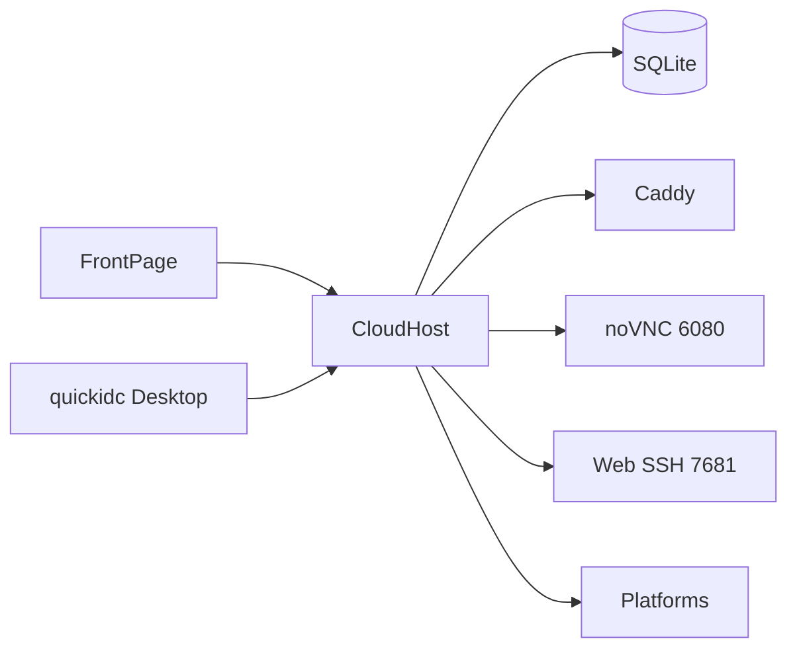

# Structure & development

Repositories, stack and layout first; then how to build, test and release.

## Repositories

| Repository | Role | Stack | Artifact |
|---|---|---|---|
| `CloudHost` | controller + plugins | Go, Gin, SQLite, Cobra | single binary, installers |
| `FrontPage` | web console | React, TypeScript, Vite, Ant Design | static site bundled into `static/` |
| `CloudInit` | in-guest agent | Go | `cloudinit` binary |
| `Documents` | documentation | VitePress, Vue 3 | static site |
| `XiaoheiFS` | separate business system | Go + React + Flutter | independent |

Financial plugins now live in `CloudHost/plugins/`.

## Stack



## Controller layout

```text
CloudHost/
├── cmd/{server,quickidc}
├── internal/{api,auth,data,driver,model,scheduler,security,service,task}
├── pkg/{utils,validator}
├── static/            # frontend build
├── VNCConsole/        # noVNC
├── packaging/         # Inno / pkg
├── plugins/           # billing modules
└── scripts/
```

## Ports & data

| Port | Process | Purpose |
|---|---|---|
| 1881 | hostagent | HTTP + API + static |
| 6080 | hostagent | VNC proxy |
| 7681 | hostagent | Web SSH |
| 2019 | caddy | Admin API (local) |

| Data | Location |
|---|---|
| Database | `<data-dir>/data.db` (SQLite, WAL) or external MySQL / PostgreSQL |
| Caddyfile | `<data-dir>/Caddyfile` |
| Logs | `<data-dir>/logs/` |

## Run it locally

```bash
git clone https://github.com/QuickIDC/CloudHost.git
cd CloudHost
go mod download
go run ./cmd/server --data-dir ./data

git clone https://github.com/QuickIDC/FrontPage.git
cd FrontPage
npm install
npm run dev
```

Read [conventions](/en/structure/conventions) before changing code, and run the checks before opening a PR:

```bash
go build ./... && go vet ./... && go test ./...
npx tsc --noEmit && npm run build
```

## Pages

- [Architecture](/en/structure/architecture)
- [API overview](/en/structure/api)
- [Environment](/en/structure/environment)
- [Build & debug](/en/structure/build)
- [Conventions](/en/structure/conventions)
- [Release](/en/structure/release)
