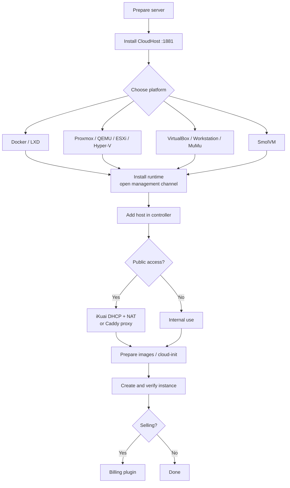

# Deployment overview

Install the controller first, then connect platforms, configure networking, and finally attach billing.

## Sections

| Section | Content |
|---|---|
| [Install CloudHost](/en/deploy/core-install) | one-liner and manual install |
| [Quick start](/en/deploy/quick-start) | first instance in ten minutes |
| [Platform deployment](/en/deploy/platform/) | Docker, LXD, Proxmox, ESXi, Hyper-V, QEMU, VirtualBox, SmolVM, MuMu |
| [Network setup](/en/deploy/network) | iKuai, DHCP, NAT (maintainer-written) |
| [Host configuration](/en/deploy/host-config/) | connect each platform to the controller |
| [Images & CloudInit](/en/deploy/images) | images and cloud-init |
| [CloudInit Agent](/en/deploy/cloudinit) | in-guest agent |
| [Billing](/en/deploy/finance/) | plugins |

## End-to-end flow



## Topologies

### Single host

```text
One Linux host
├── CloudHost (1881)
├── Docker / LXD
└── Caddy (optional)
```

Use `localhost` as the host address.

### Controller + multiple hosts

```text
CloudHost
   ├── Proxmox 10.0.0.21:8006
   ├── LXD     10.0.0.32 (SSH)
   └── Hyper-V 10.0.0.44:5985
```

### Controller + iKuai relay

```text
Users → public IP (iKuai) → DNAT → instance
Controller → iKuai API (DHCP static binding)
```

Set `proxy_mode = relay` and fill `relay_addr`.

## Ports

| Port | Service |
|---|---|
| 1881 | controller HTTP/API |
| 6080 | VNC proxy |
| 7681 | Web SSH |
| 2019 | Caddy Admin (local) |
| 8006 / 443 / 5985 / 8697 | platform APIs |

## Pre-flight checks

- [ ] Virtualization enabled in BIOS
- [ ] Time sync configured
- [ ] Disk plan for images and backups
- [ ] Firewall rules for controller and platforms
- [ ] A safe place for the initial Bearer token
