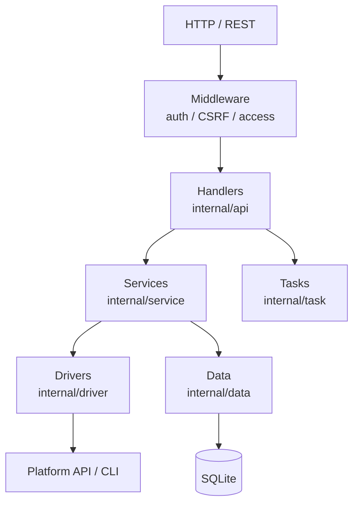

# Architecture

## Layers



| Layer | Responsibility |
|---|---|
| Handler | parse, authorize, respond |
| Service | orchestration, transactions, tasks |
| Driver | platform interaction and capability checks |
| Data | persistence |
| Task | async execution, progress, retry |

## Request flow

```text
auth (Bearer / session) → CSRF (writes) → access control
→ handler → service → driver (or task) → { code, msg, data, timestamp }
```

## Authentication

| Mode | Use | Credential |
|---|---|---|
| Bearer | API, CLI, plugins | `Authorization: Bearer <token>` |
| Session | browser | cookie |

Tokens are 32 random bytes (64 hex chars). Resetting invalidates old credentials.

## CSRF

Writes require `X-CSRF-Token`, obtained from `GET /api/csrf-token`. GET/HEAD/OPTIONS are exempt. The CLI handles this automatically.

## Drivers

`internal/driver/interface.go` defines `HostDriver` (list, create, update, delete, power, VNC, screenshot, backups). A new platform = implement the interface + register in `createDriver` and `engine_config`.

## Capability metadata

`EngineMeta` fields: `enabled`, `is_remote`, `platform`, `arch`, `options`, `messages`, `ban_init`, `ban_edit`, `tab_lock`. The UI renders from it.

## Tasks

In-memory queue with 4 workers; writes to the same instance are serialized; tasks are persisted and resumable.

## Data model

| Table | Content |
|---|---|
| `users` | accounts, roles, quotas |
| `hosts` | host config and status |
| `vms` | instances and ownership |
| `tasks` | async tasks |
| `logs` | database logs |
| `settings` | key/value settings |
| `outbox` / `tombstone` | reconciliation |

## Maintenance jobs

Host sync, quota recalculation, outbox retry, tombstone sweep, screenshot cleanup.

## Static assets

Gin serves `static/` and falls back to `index.html` for SPA routes; `VNCConsole/` hosts noVNC; Caddy runs as a child process managed through its Admin API.
