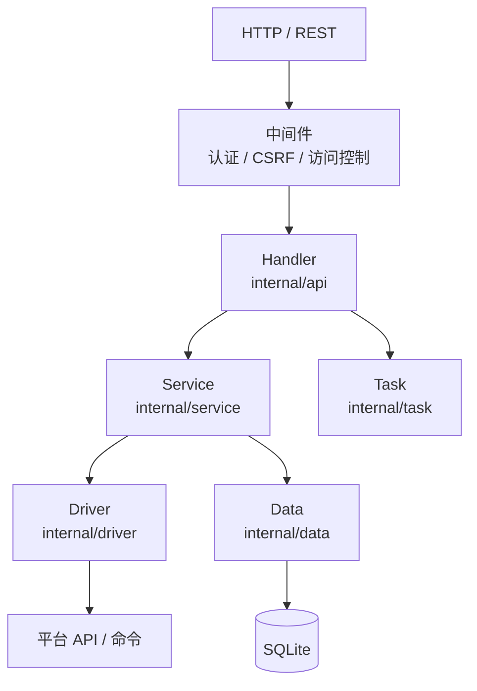

# 技术架构

## 分层



| 层 | 职责 | 不该做的事 |
|---|---|---|
| Handler | 解析参数、鉴权、返回统一响应 | 写业务规则 |
| Service | 编排业务、事务、任务提交 | 拼 SQL |
| Driver | 与平台交互、能力判定 | 处理 HTTP |
| Data | 持久化与查询 | 调用平台 |
| Task | 异步执行、进度、重试 | 直接返回 HTTP |

## 请求生命周期

```text
请求 → 认证（Bearer / Session）
     → CSRF（写操作）
     → 访问控制（管理员 / 归属）
     → Handler 参数校验
     → Service 业务
     → Driver 平台调用（或提交任务）
     → 统一响应 { code, msg, data, timestamp }
```

## 认证

两种模式并存：

| 模式 | 场景 | 凭据 |
|---|---|---|
| Bearer Token | API、CLI、插件 | `Authorization: Bearer <token>` |
| Session | 浏览器登录 | Cookie（`openidcs_session`） |

- Token 为 32 字节随机数的十六进制（64 字符）；
- 重置 Token 会使旧凭据立即失效；
- 会话记录「口令标记」，改密后旧会话失效。

## CSRF

写操作（POST/PUT/DELETE/PATCH）需要 `X-CSRF-Token`：

```bash
# 1. 获取
curl -s https://idc.example.com/api/csrf-token
# {"csrf_token":"..."}

# 2. 带 Token 调用
curl -X POST ... -H "Authorization: Bearer $TOKEN" -H "X-CSRF-Token: ..."
```

GET / HEAD / OPTIONS 不校验。CLI 的 HTTP 客户端会自动完成这一步。

## 驱动接口

`internal/driver/interface.go` 定义平台能力，核心方法：

```go
type HostDriver interface {
    Connect() error
    ListVMs() ([]VMInfo, error)
    GetVM(uuid string) (*VMInfo, error)
    CreateVM(cfg *VMConfig) (string, error)
    UpdateVM(cfg, old *VMConfig) error
    DeleteVM(uuid string) error
    PowerVM(uuid, action string) error
    GetVNCInfo(uuid string) (*VNCInfo, error)
    GetScreenshot(uuid string) (string, error)
    CreateBackup(uuid string, opt BackupOption) error
    RestoreBackup(uuid, name string) error
    DeleteBackup(uuid, name string) error
    // ...
}
```

新增平台 = 实现接口 + 在 `createDriver` 与 `engine_config` 注册。

## 平台能力元信息

`engine_config.go` 的 `EngineMeta` 决定前端表单：

| 字段 | 作用 |
|---|---|
| `enabled` | 是否对外暴露 |
| `is_remote` | 是否支持远程接入 |
| `platform` / `arch` | 本机平台限制 |
| `options` | 平台专属参数说明 |
| `messages` | 表单提示 |
| `ban_init` / `ban_edit` | 禁用字段 |
| `tab_lock` | 锁定的详情页签 |

## 任务模型

- 内存队列 + 4 worker；
- 同一实例的写操作串行；
- 任务持久化，重启后可恢复未完成任务；
- 失败保留错误与最后一步。

## 数据模型（主要表）

| 表 | 内容 |
|---|---|
| `users` | 用户、角色、配额 |
| `hosts` | 主机配置与状态 |
| `vms` | 实例记录、归属 |
| `tasks` | 异步任务 |
| `logs` | 数据库日志 |
| `settings` | 全局键值 |
| `outbox` / `tombstone` | 对账与删除墓碑 |

数据库为 SQLite（WAL），单文件备份即可。

## 定时维护

| 任务 | 作用 |
|---|---|
| 主机同步 | 修正实例状态 |
| 配额重算 | 修正用量 |
| 对账 | 重试 outbox、扫描墓碑 |
| 截图清理 | 删除过期缩略图 |

## 静态资源与代理

- `static/` 由 Gin 直接提供，未命中路由回退 `index.html`（SPA）；
- `VNCConsole/` 提供 noVNC 页面；
- Caddy 以子进程运行，主控写 `Caddyfile` 并调用 Admin API 重载。

## 安全设计

| 面 | 措施 |
|---|---|
| 凭据 | Token 哈希/掩码、配置 0600 |
| 会话 | 改密失效、CSRF |
| 命令执行 | 参数白名单、shell 转义（`shellsafe.go`） |
| SSH | TOFU 主机密钥持久化 |
| 平台证书 | 支持自签，生产建议受信证书 |

## 相关页面

- [仓库与技术栈](/structure/)
- [API 概览](/structure/api)
- [开发指南](/dev/)
