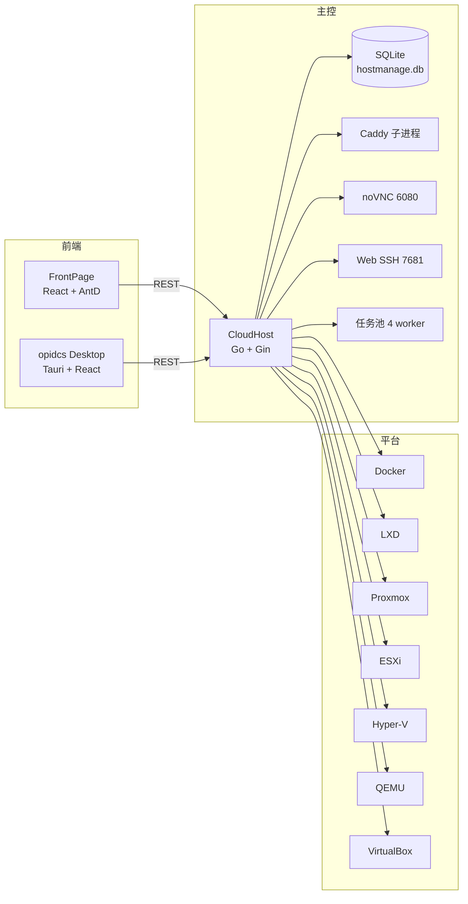

# 仓库与技术栈

OpenIDCS 由多个仓库组成，各自独立发布，通过 REST API 与约定的数据格式协作。

## 仓库

| 仓库 | 作用 | 技术栈 | 产物 |
|---|---|---|---|
| `OpenIDCSTeam/CloudHost` | 主控 + 财务插件 | Go 1.26、Gin、SQLite、Cobra | 单二进制 `hostagent`、安装包 |
| `OpenIDCSTeam/FrontPage` | 浏览器控制台 | React 18、TypeScript、Vite、Ant Design | 静态站点（打进主控 `static/`） |
| `OpenIDCSTeam/CloudInit` | 虚拟机内 Agent | Go | `cloudinit` 二进制 |
| `OpenIDCSTeam/Documents` | 文档站 | VitePress、Vue 3 | 静态站点（GitHub Pages） |
| `OpenIDCSTeam/XiaoheiFS` | 业务侧系统（独立） | Go + React + Flutter | 各自产物 |

> 财务插件已并入 `CloudHost/plugins/`，不再单独发布仓库。

## 技术栈总览



## 主控目录

```text
CloudHost/
├── cmd/
│   ├── server/          # 主控入口（cobra）
│   └── opidcs/          # 管理命令行
├── internal/
│   ├── api/             # 路由与 handler
│   ├── auth/            # 认证、CSRF、权限
│   ├── data/            # SQLite 访问层
│   ├── driver/          # 各平台驱动 + 引擎元信息
│   ├── model/           # 数据模型
│   ├── scheduler/       # 定时任务
│   ├── security/        # 加密、主机密钥
│   ├── service/         # 业务服务（主机/代理/NAT/…）
│   └── task/            # 异步任务
├── pkg/
│   ├── utils/           # 响应、Token、通用工具
│   └── validator/
├── static/              # 前端构建产物
├── VNCConsole/          # noVNC 静态页
├── packaging/           # Windows Inno / macOS pkg
├── plugins/             # 财务系统插件
└── scripts/             # 安装脚本
```

## 端口与进程

| 端口 | 进程 | 说明 |
|---|---|---|
| 1881 | hostagent | HTTP + API + 静态资源 |
| 6080 | hostagent | VNC websockify 代理 |
| 7681 | hostagent | Web SSH |
| 2019 | caddy | Admin API（仅本机） |

## 数据

| 数据 | 位置 |
|---|---|
| 主库 | `<data-dir>/hostmanage.db`（WAL） |
| Caddy 配置 | `<data-dir>/Caddyfile` |
| 日志 | `<data-dir>/logs/` 或独立目录 |
| 静态资源 | 工作目录下 `static/`、`VNCConsole/` |

## 发布节奏

| 组件 | 触发 |
|---|---|
| 主控 | `v*` tag 或手动运行 Release 工作流 |
| 前端 | 随主控构建（构建产物进 `static/`） |
| CloudInit | 独立 tag |
| 文档 | `main` 分支推送即部署 |

## 下一步

- [技术架构](/structure/architecture)
- [API 概览](/structure/api)
- [开发指南](/dev/)
